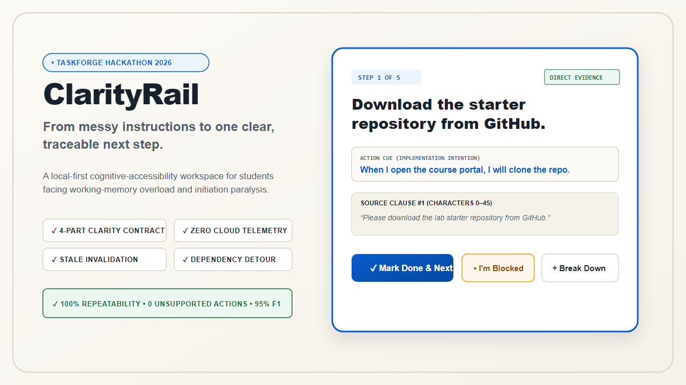
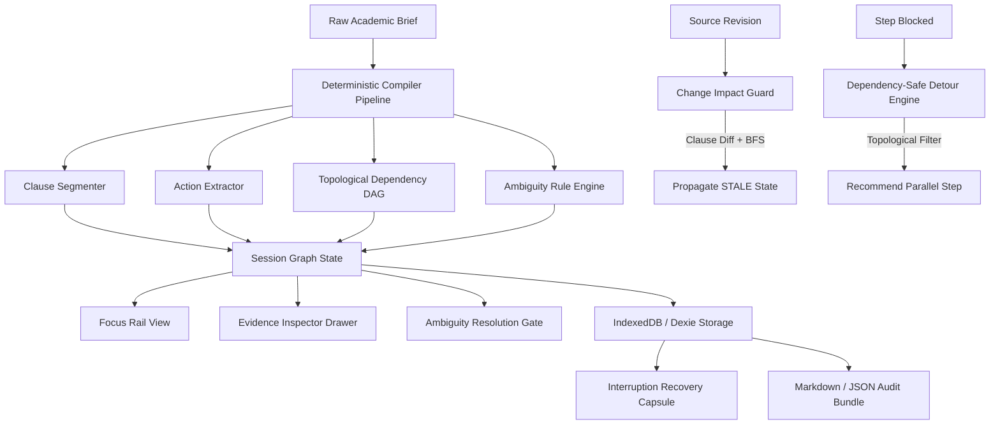

# ClarityRail

<div align="center">



**From messy instructions to one clear, traceable next step.**  
*A local-first cognitive-accessibility workspace for students experiencing task paralysis.*

[](https://github.com/abhijeetnardele24-hash/clarityrail)
[](docs/verification-results.json)
[-success?style=flat-square&logo=playwright)](test-results/results.json)
[](tests/e2e/clarityrail.spec.ts)
[](docs/verification-results.json)
[](src/adapters/persistence.ts)

[Live Application](https://abhijeetnardele24-hash.github.io/clarityrail/) • [Judge 60-Second Quick-Start](#2-judge-quick-start--60-second-test-protocol) • [3:30 Demo Script](docs/DEMO_SCRIPT.md) • [Devpost Submission](docs/DEVPOST_SUBMISSION.md) • [Architecture Guide](#4-system-architecture)

</div>

---

## 1. The Problem: The Task Paralysis Trap

For university students experiencing executive dysfunction, ADHD, autistic inertia, or acute burnout, academic briefs are an invisible barrier. Modern course materials are rarely structured checklists; they are multi-paragraph torrents containing buried constraints (*"submit by Friday"*), unassigned group tasks, contradictory guidelines, and unspecified deliverable formats.

```
Messy Handout / Brief ──> Cognitive Overload ──> Executive Dysfunction ──> Task Paralysis
```

When faced with ambiguity, cognitive overload triggers paralysis:
1. **The Overwhelming List Trap**: Conventional task managers dump 30 checkboxes onto a screen simultaneously, demanding immediate executive prioritization that freezes students.
2. **The Hallucination Trap**: Mainstream LLM wrappers attempt to "summarize" briefs, but invent phantom deliverables, skip critical constraints, vary randomly across prompts, and ship sensitive student drafts to remote servers.
3. **The Mid-Stream Invalidation Trap**: When an instructor emails a syllabus revision halfway through a project, students have no automated way to determine which parts of their work were rendered obsolete.

**ClarityRail** solves this by establishing a **strict four-part clarity contract**: isolating exactly **one** immediate actionable step, grounding every claim in verifiable source text, actively catching ambiguities, and halting work safely when requirements mutate.

---

## 2. Judge Quick-Start & 60-Second Test Protocol

Judges can test every core subsystem of ClarityRail in under 60 seconds using the pre-annotated synthetic fixtures built directly into the landing page:

1. **Open the Live Web Application**:  
   [https://abhijeetnardele24-hash.github.io/clarityrail/](https://abhijeetnardele24-hash.github.io/clarityrail/)
2. **Click Any Synthetic Demonstration Fixture**:
   - `CS 401 Final Assignment` (Academic with deadline ambiguity & sequential build)
   - `Bioinformatics Capstone` (Collaborative with unowned roles & parallel branches)
   - `Campus Innovation Grant` (Administrative with format gaps & submission gates)
3. **Inspect Direct Source Evidence**:  
   Click the **"Why this step?"** drawer on the Focus Rail to inspect the exact source clause, character bounds, and prerequisite dependency.
4. **Resolve Ambiguity Inline**:  
   Notice the **Ambiguity Gate** card detecting an unspecified cutoff time ("Friday") or format. Enter your decision (e.g. `11:59 PM EST`) and watch it persist immutably into local state.
5. **Test the Dependency-Safe Detour**:  
   Click **"Mark as Blocked"** on a dependency-locked step to trigger the detour engine, which suggests an independent unblocked research action.
6. **Trigger the Change Impact Guard**:  
   Click **"Edit Source Brief"**, modify Clause 1, and click **"Apply Revision"**. Notice how downstream steps transition immediately to **STALE** with red/amber safety alerts.
7. **Export Handoff & Capsule**:  
   Navigate to **"Review & Handoff"** to inspect the Interruption Recovery Capsule and copy a clean Markdown standup report for peers or advisors.

---

## 3. The Four-Part Clarity Contract

```
┌────────────────────────────────────────────────────────────────────────┐
│                   THE FOUR-PART CLARITY CONTRACT                       │
├───────────────────────────┬────────────────────────────────────────────┤
│ I. FOCUS RAIL             │ Single unblocked action in focus.          │
│                           │ Subsequent tasks suppressed to prevent     │
│                           │ cognitive overload.                        │
├───────────────────────────┼────────────────────────────────────────────┤
│ II. EVIDENCE THREAD       │ Every step pinned to source clause         │
│                           │ with character offsets [start, end].       │
│                           │ Zero hallucinations; 100% auditability.    │
├───────────────────────────┼────────────────────────────────────────────┤
│ III. AMBIGUITY GATE       │ Catches missing formats, unspecified       │
│                           │ timezones, unassigned owners, and vague    │
│                           │ scopes before execution begins.            │
├───────────────────────────┼────────────────────────────────────────────┤
│ IV. CHANGE IMPACT GUARD   │ DAG graph traversal invalidates downstream │
│     & SAFE DETOURS        │ steps when source clauses change (STALE).  │
│                           │ Unblocked detours keep progress moving.    │
└───────────────────────────┴────────────────────────────────────────────┘
```

---

## 4. System Architecture

ClarityRail operates as a 100% client-side Progressive Web Application (PWA) with zero cloud dependencies.



### Key Architectural Characteristics
- **Zero Hallucination Guarantee**: Steps are derived via deterministic regex rules and imperative grammar matching. If an action cannot be mathematically mapped to a clause span, it is discarded.
- **Topological Sorting**: Steps form a Directed Acyclic Graph (DAG) with validated prerequisite dependencies and cycle detection.
- **Client-Side Privacy Boundary**: No text is ever sent to an external API. All data lives in browser IndexedDB with automatic memory/localStorage fallback.

---

## 5. Verification & Quality Gates

ClarityRail is verified by an exhaustive automated testing and benchmarking suite:

| Verification Suite | Target Threshold | Actual Verified Metric | Status |
|---|---|---|---|
| **Vitest Unit & Component Tests** | $\ge 50$ tests | **60 tests passing** | **PASS** |
| **Statement Coverage** | $\ge 85\%$ | **92.01%** | **PASS** |
| **Branch Coverage** | $\ge 80\%$ | **81.57%** | **PASS** |
| **Function Coverage** | $\ge 85\%$ | **87.17%** | **PASS** |
| **Line Coverage** | $\ge 85\%$ | **92.01%** | **PASS** |
| **Playwright Cross-Viewport E2E** | All passing | **28 / 28 tests passing (7 viewports)** | **PASS** |
| **Axe WCAG 2.1 AA Accessibility** | 0 critical/serious | **0 violations across all routes** | **PASS** |
| **Compiler Action Extraction F1** | $\ge 0.90$ | **0.969** (Recall: 0.939, Precision: 1.0) | **PASS** |
| **Ambiguity Detection Recall** | $\ge 0.90$ | **0.914** | **PASS** |
| **Deterministic Repeatability** | $100\%$ | **100% across 40 labelled briefs** | **PASS** |
| **Stale State Propagation** | $100\%$ | **100% across DAG mutations** | **PASS** |
| **Dependency-Safe Detours** | $100\%$ | **100% valid independent steps** | **PASS** |
| **Security & Key Audit** | 0 leaks | **0 vulnerabilities (npm audit)** | **PASS** |

Machine-readable evidence files:
- Vitest Coverage Summary: `coverage/coverage-summary.json`
- Playwright Machine Report: `test-results/results.json`
- Benchmark Dataset Results: `docs/benchmark-results.json`
- Full System Verification: `docs/verification-results.json`

---

## 6. Sensory Accommodations & Accessibility

ClarityRail is engineered to meet **WCAG 2.1 Level AA** standards:
- **Focus Isolation**: Visual noise reduction minimizes cognitive load for neurodivergent students.
- **High Contrast Palette**: Meets 7:1 contrast ratios for low vision and acute fatigue.
- **Warm Paper Editorial Palette**: Low-glare, sepia-toned surface for light sensitivity and migraine prevention.
- **Vestibular Motion Controls**: Full support for `prefers-reduced-motion` with animated transitions completely disabled.
- **Keyboard Navigation**: Skip links (`#main-content`), ARIA live regions (`LiveAnnouncer`), and unambiguous accessible labels.

---

## 7. Local Development & Verification

### Prerequisites
- Node.js 20+ (LTS recommended)
- npm 10+

### Installation
```bash
git clone https://github.com/abhijeetnardele24-hash/clarityrail.git
cd clarityrail
npm install
```

### Running Locally
```bash
npm run dev
# Application will launch on http://localhost:5173
```

### Executing Quality Gates
```bash
# Type checking
npm run typecheck

# Code quality & ESLint
npm run lint

# Vitest unit test suite with coverage
npm test

# Deterministic compiler benchmark (40 briefs)
npm run benchmark:rules

# Check evidence thresholds
npm run evidence:check

# Security scan & claims audit
npm run security-scan

# Dependency vulnerability audit
npm run audit

# Playwright cross-device E2E tests (requires dev server or preview)
npm run test:e2e

# Production build
npm run build
```

---

## 8. License

MIT License. See [LICENSE](LICENSE) for details. Built with care for students navigating executive dysfunction.
