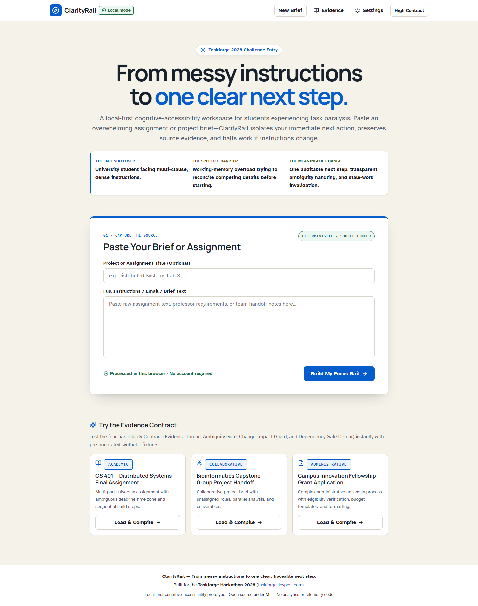
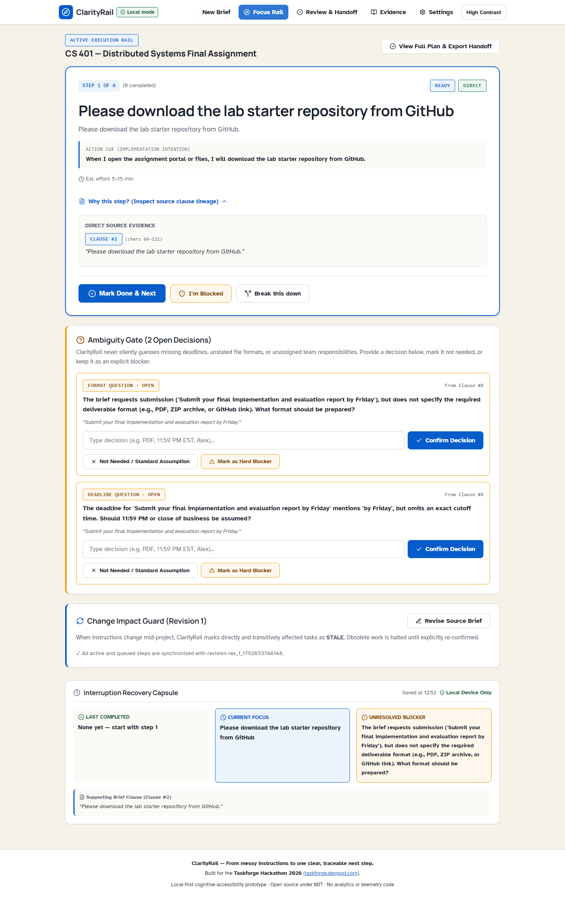
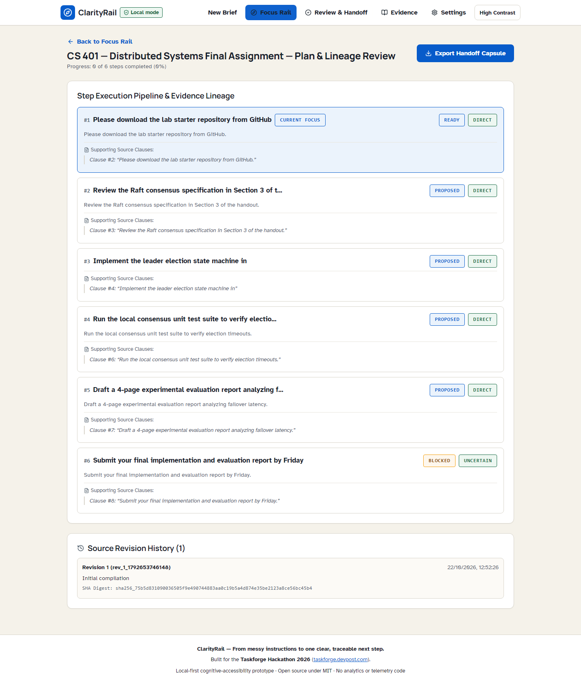
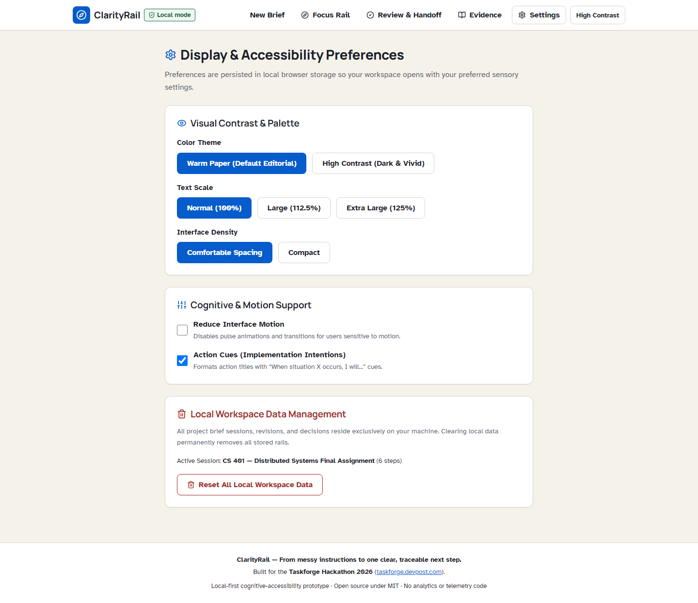

# ClarityRail

<div align="center">


**From messy instructions to one clear, traceable next step.**  
A local-first cognitive-accessibility workspace for students facing task-initiation overload.

[Live app](https://abhijeetnardele24-hash.github.io/clarityrail/) · [60-second judge path](#judge-path) · [Architecture](docs/ARCHITECTURE.md) · [Evaluation](docs/EVALUATION.md) · [Devpost copy](docs/DEVPOST_SUBMISSION.md)

</div>

## Why it exists

Dense assignment briefs often combine actions, prerequisites, unclear deadlines, and later revisions. A conventional checklist reproduces that overload. ClarityRail instead exposes one eligible action, shows the source text that supports it, asks the user to resolve material ambiguity, and stops affected work when the source changes.

The project is deliberately deterministic. It does not call an LLM, infer facts beyond its documented rules, or send brief text to a remote application service.

## The clarity contract

| Mechanism | What the user sees | Safety property |
|---|---|---|
| **Focus Rail** | One current action and a short cue | Later work stays out of the primary visual field |
| **Evidence Thread** | Exact clause text and character bounds | Every emitted step is traceable to source text |
| **Ambiguity Gate** | Questions for missing cutoff, format, owner, or scope | Open material questions can prevent readiness |
| **Change Impact Guard** | Changed and downstream steps become `STALE` | Revised instructions require explicit review |
| **Dependency-Safe Detour** | An independent `READY` step when blocked | The detour never bypasses an unmet prerequisite |

## Judge path

1. Open the [live app](https://abhijeetnardele24-hash.github.io/clarityrail/).
2. Choose **CS 401 — Distributed Systems Final Assignment** under *Judge Quick-Start*.
3. Expand **Why this step?** to inspect its direct source clause.
4. Resolve an ambiguity, mark a step done, then block the next step to see a safe detour.
5. Select **Edit Source Brief**, change the report requirement, and apply the revision. Affected steps become `STALE` until reviewed.
6. Open **View Full Plan & Export Handoff** to inspect the recovery capsule and local export.

## Product proof


The compiler segments text, extracts supported actions, builds and validates a dependency DAG, evaluates ambiguity rules, and assigns a SHA-256 content digest to canonical revision content. The UI and state machine run inside the browser. Sessions use IndexedDB through Dexie, with documented local fallbacks. The generated service worker supports a tested offline reload after an initial online load.


State transitions are explicit: `PROPOSED`, `READY`, `IN_PROGRESS`, `BLOCKED`, `DONE`, and `STALE`. A source revision is never silently accepted as equivalent; changed clauses and transitive dependants are re-reviewed.

## Screenshots

| Compile an evidence-linked brief | Work from one guarded action |
|---|---|
|  |  |

| Inspect the full plan | Adjust sensory preferences |
|---|---|
|  |  |

## Verified engineering evidence

The repository uses a fail-closed evidence pipeline: a verification run deletes stale outputs, executes all gates, parses machine-readable results, checks artifact freshness, and refuses missing, failed, skipped, or flaky evidence.

| Gate | Current verified result |
|---|---:|
| TypeScript / ESLint | 0 errors / 0 warnings |
| Vitest | 78 / 78 passing |
| Coverage | 92.03% statements · 81.40% branches · 87.50% functions · 92.03% lines |
| Playwright | 33 / 33 executions across 7 responsive viewport profiles plus deep Chromium checks |
| Automated Axe scope | 31 scans · 0 serious or critical findings in the tested states |
| Deterministic benchmark | 40 synthetic briefs · F1 0.969 · ambiguity recall 0.914 · repeatability 100% |
| Offline behavior | Installed service worker reload verified after an initial online load |
| Production dependencies | 0 high-severity vulnerabilities reported by `npm audit --omit=dev` |

These are automated results for the tested fixtures, routes, browsers, and states—not a certification or a claim about every possible document. See [evaluation scope](docs/EVALUATION.md) and [`docs/verification-results.json`](docs/verification-results.json).

## Architecture decisions

- **No neural inference:** deterministic TypeScript rules keep behavior reproducible and inspectable.
- **Canonical SHA-256 digest:** revision content is normalized before hashing; the digest provides content-integrity comparison, not a signature or immutable ledger.
- **Local-first persistence:** brief text and sessions remain in browser-managed storage during normal operation; users control exports.
- **Fail-safe revision handling:** changed source clauses and dependent steps become `STALE` before further execution.
- **Accessible interaction:** keyboard-operable dialogs trap focus, restore the trigger on close, and support Escape; responsive tests cover 320–1920 px.

Detailed documents: [architecture](docs/ARCHITECTURE.md), [accessibility](docs/ACCESSIBILITY.md), [privacy and threat model](docs/PRIVACY_AND_THREAT_MODEL.md), and [requirement-to-evidence matrix](docs/REQUIREMENTS_EVIDENCE_MATRIX.md).

## Run locally

Requirements: Node.js 20+ and npm 10+.

```bash
git clone https://github.com/abhijeetnardele24-hash/clarityrail.git
cd clarityrail
npm ci
npm run dev
```

Run every quality gate:

```bash
npx playwright install --with-deps chromium firefox webkit
npm run verify
```

Individual commands are available for `typecheck`, `lint`, `test`, `benchmark`, `security-scan`, `audit`, `build`, and `test:e2e`.

## Limits and responsible claims

- The rule engine is evaluated on 40 deterministic synthetic briefs; it is not a general document-understanding benchmark.
- Generated steps should be reviewed against the displayed source evidence before consequential use.
- Local browser storage is private from this application’s server because there is no application backend, but device security, browser extensions, exports, and shared profiles remain external risks.
- Automated accessibility scans and interaction tests do not replace manual testing with assistive technologies and people with lived experience.

## License

[MIT](LICENSE). Typeface files are redistributed under their upstream SIL Open Font License terms; see [`docs/licenses`](docs/licenses/).
