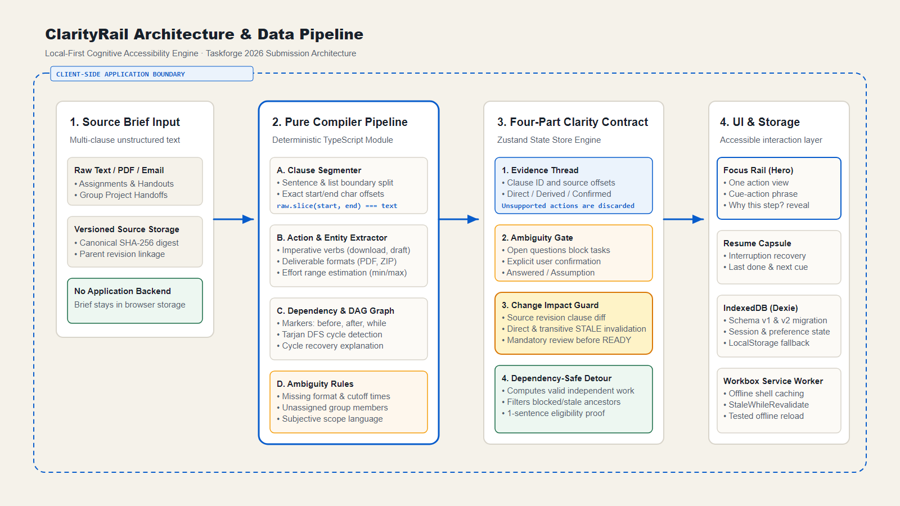
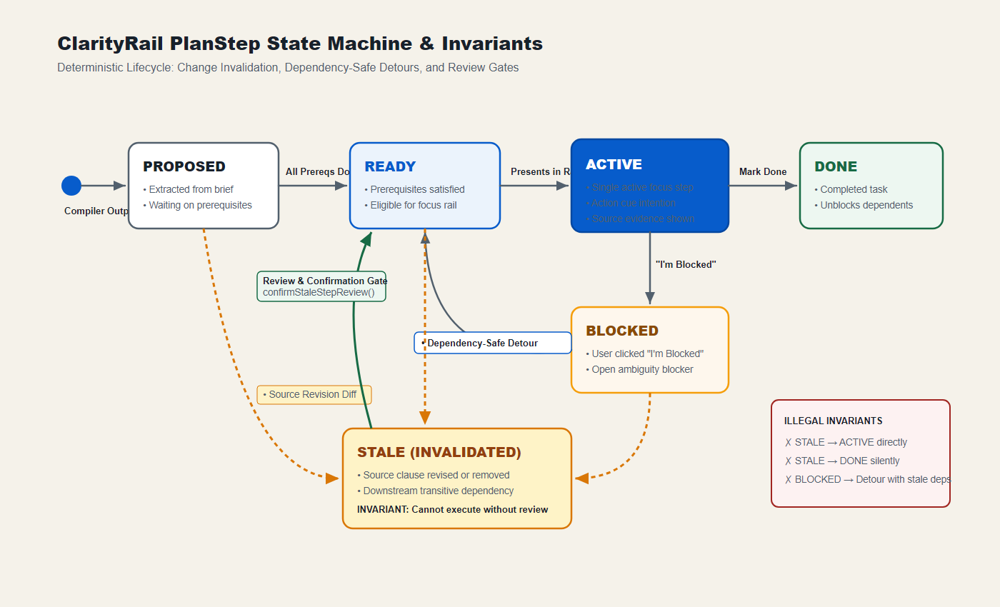

# Architecture

## Runtime boundary

ClarityRail is a static browser application. GitHub Pages serves HTML, JavaScript, CSS, font, manifest, and service-worker files; it does not receive brief text or session state. The user may explicitly export Markdown or JSON files.

## Compiler pipeline

1. **Canonicalize and segment:** preserve exact source offsets while splitting prose and list clauses.
2. **Extract:** match documented action verbs, deliverables, deadlines, and dependency markers.
3. **Build graph:** create prerequisite edges, reject cycles, and compute readiness centrally.
4. **Detect ambiguity:** generate deterministic questions for missing cutoff, format, ownership, or vague scope.
5. **Digest revision:** normalize canonical fields and compute a SHA-256 content digest.

The digest is a content-integrity comparison tool. It is not a digital signature, proof of authorship, timestamp authority, or immutable ledger.

## Execution state machine

- `PROPOSED`: extracted but not yet eligible.
- `READY`: prerequisites satisfied and no blocking ambiguity applies.
- `IN_PROGRESS`: selected active work.
- `BLOCKED`: user reports the action cannot proceed.
- `DONE`: user marks the action completed.
- `STALE`: its source clause or a prerequisite lineage changed and requires review.

The detour selector considers only `READY` candidates and proves that the candidate does not depend on the blocker. Revision diffing is intentionally conservative: ordinal clause changes invalidate the mapped step and transitive descendants.

## Persistence and offline behavior

Dexie stores schema-versioned sessions in IndexedDB. A localStorage adapter and memory implementation provide controlled fallbacks. Unit tests exercise migration, persistence across store reinitialization, and clear/reset behavior.

The generated Workbox service worker precaches the production shell. Browser verification visits online, waits for service-worker readiness, then reloads offline. This proves that tested installed-shell behavior; it does not claim every external link or uncached resource works offline.

## Evidence pipeline

`npm run verify` starts by deleting stale result files and writing a verification-run marker. Subsequent gates emit JSON for coverage, unit results, benchmark results, Axe scans, and Playwright. The final report checks result freshness, exact pass/fail/skip counts, the production bundle, and current Git SHA.

## Main modules

| Concern | Location |
|---|---|
| Compiler and SHA-256 | `src/domain/compiler/` |
| Revision diff and propagation | `src/domain/revision/` |
| Safe detours | `src/domain/detour/` |
| State orchestration | `src/application/store.ts` |
| IndexedDB and exports | `src/adapters/` |
| Routes and accessible components | `src/ui/` |
| Machine verification | `scripts/`, `tests/` |
